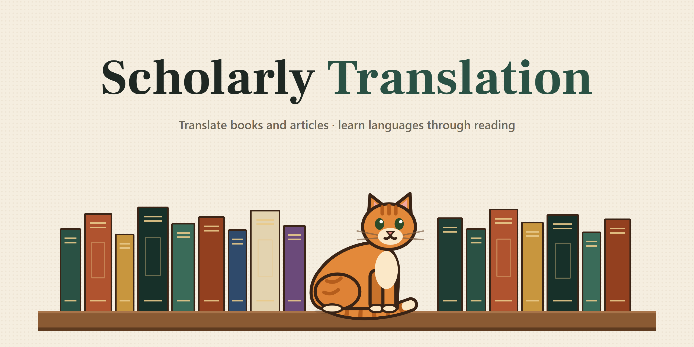

<p align="center">
  
</p>

<h1 align="center">Scholarly Translation · תרגום מסמכים לעברית</h1>

<p align="center">
  <a href="https://github.com/{{DIST_REPO}}/releases/latest/download/ScholarlyTranslation-Setup.exe"><b>⬇ הורדה ל־Windows · Download for Windows</b></a>
  <br>
  <a href="#עברית">עברית</a> · <a href="#english">English</a>
</p>

---

<div dir="rtl" lang="he">

<h2 id="עברית">עברית</h2>

### מה זה?

**Scholarly Translation** היא תוכנה למחשב Windows שמתרגמת ספרים ומאמרים לעברית, ועוזרת ללמוד שפה דרך קריאה בעברית. היא רצה על המחשב שלכם ונפתחת בדפדפן. אין חשבון, אין שרת חיצוני ואין מנוי. התרגום עצמו נעשה במודל בינה מלאכותית, עם מפתח API שלכם.

- **תרגום מסמכים**: מעלים PDF או EPUB (עד ‎25 MB) ומקבלים אותו מתורגם באותו פורמט. אפשר לעבור על התרגום ולערוך אותו.
  - **שפת מקור**: זיהוי אוטומטי, אנגלית, צרפתית או יפנית.
  - **שפת יעד**: עברית. אנגלית זמינה עם מודל משלכם.
  - **שני סגנונות**: אקדמי (מדויק, ההערות והמינוח נשמרים) או ספרותי (זורם ונאמן לסגנון).
  - **"המונחים שלי"**: מילון אישי של מונחים שמחייב בכל תרגום.
  - **ספרים סרוקים**: נתמכים דרך זיהוי טקסט (OCR) על המחשב. ראו [ספרים סרוקים](#ספרים-סרוקים-ocr) בהמשך.
  - **הספרייה**: כל התרגומים, המוכנים ואלה שבתהליך, נשמרים בה. אפשר לעצור תרגום ולהמשיך אותו אחר כך.
- **למידת שפה דרך ספרים בעברית**: הכפתור "למידת שפה" לוקח ספר עברי (EPUB, או תרגום מוכן מהספרייה) ומשלב בו בהדרגה מילים וביטויים מהשפה שאתם לומדים. הם חוזרים לאורך הפרקים, ואפשר לייצא את הספר ל־EPUB או ל־HTML לקריאה בלי חיבור לאינטרנט.
  - **השפות**: צרפתית, גרמנית, ספרדית, יידיש, איטלקית וערבית ספרותית.
- **ממשק בעברית ובאנגלית**, עם דף עזרה מובנה.

### דרישות

- Windows 10 או Windows 11 (64 ביט).
- חיבור לאינטרנט בזמן ההתקנה ובזמן תרגום.
- כ־300 MB פנויים בדיסק.
- אין צורך בהרשאות מנהל.
- אין צורך להתקין Python מראש: אם הוא חסר, ההתקנה מתקינה אותו לבד, למשתמש שלכם בלבד.

### התקנה

1. **הורידו** את [`ScholarlyTranslation-Setup.exe`](https://github.com/{{DIST_REPO}}/releases/latest/download/ScholarlyTranslation-Setup.exe) מעמוד ה־[Releases](https://github.com/{{DIST_REPO}}/releases/latest).
2. **הפעילו** את הקובץ בלחיצה כפולה.
   - Windows עלול להציג את ההודעה **"Windows protected your PC"**. זה קורה כי הקובץ עדיין לא חתום בתעודה מסחרית. לחצו **More info** ואז **Run anyway**.
   - אם תוכנת אנטי־וירוס עוצרת את הקובץ, אפשר לאשר אותו בה או להשתמש [בהתקנה החלופית](#התקנה-חלופית-קובץ-zip).
3. **חלון ההתקנה** עושה את הכל לבד. זה לוקח כמה דקות:
   - מתקין Python 3.12 אם הוא חסר.
   - מוריד את הרכיבים הדרושים.
   - בודק שהכל עובד.
   - יוצר על שולחן העבודה קיצור דרך בשם **Scholarly Translation**.
4. לחצו **Run now**. התוכנה נפתחת בדפדפן.

אם משהו נכשל באמצע, החלון מציג את הסיבה ואת הכפתור **Retry**. בדרך כלל הסיבה היא ניתוק מהאינטרנט.

#### התקנה חלופית (קובץ zip)

1. הורידו את [`ScholarlyTranslation-Setup.zip`](https://github.com/{{DIST_REPO}}/releases/latest/download/ScholarlyTranslation-Setup.zip).
2. **חלצו את כל התוכן** לתיקייה רגילה: קליק ימני ← "חלץ הכל". לא מספיק לפתוח את ה־zip.
3. הפעילו את `Install.bat`. ההתקנה זהה לזו של קובץ ה־EXE.

### שימוש ראשון

- **הפעלה**: פותחים את קיצור הדרך **Scholarly Translation**. נפתח חלון קטן, ואחריו האתר בדפדפן (כתובת מקומית כמו `http://127.0.0.1:…`).
  - **החלון הקטן הוא התוכנה עצמה.** אל תסגרו אותו כל עוד אתם עובדים. סגירתו עוצרת את התוכנה.
  - אם תפתחו את קיצור הדרך שוב בזמן שהתוכנה פועלת, ייפתח אותו אתר שכבר רץ.
- **ניסיון בלי מפתח ובלי עלות**: לחצו **"נסו עם PDF דוגמה, ללא עלות"**, או בחרו במודל **Auto**.
  - **שימו לב:** Auto הוא תצוגת ניסיון מדומה, ולא תרגום אמיתי.
- **תרגום אמיתי** דורש מפתח API (בסעיף הבא). אחרי שהגדרתם אותו:
  1. גוררים קובץ לחלון.
  2. ב־**אפשרויות** בוחרים פרופיל, רמת בדיקה ותקציב.
  3. לוחצים **תרגום לעברית**.
  4. לפני ששום דבר נשלח, מוצג אומדן עלות ומתבקש אישור.

### מפתח API ועלויות

התוכנה משתמשת במודל שאתם בוחרים, ואתם משלמים ישירות לספק לפי השימוש.

**הספקים הנתמכים:**
- **OpenAI** (מומלץ: `gpt-6-luna`, זול מאוד).
- **Anthropic** (Claude).
- כל שירות **תואם OpenAI**, למשל DeepSeek.

**הגדרת המפתח:**
1. פתחו **אפשרויות** ← **מודל** ← **"מודל משלי (מפתח API)"**.
2. לחצו **"איך משיגים מפתח?"**. נפתח מדריך מובנה עם הקישורים לכל ספק: יצירת מפתח, טעינת כ־5$ בקרדיט מראש, וכיבוי טעינה אוטומטית.
3. הדביקו את המפתח ולחצו **"שמירת מפתחות API"**.
   - בלי סימון נוסף, המפתח נשמר רק עד שסוגרים את התוכנה.
   - כדי שיישמר גם אחר כך, סמנו **"לזכור במחשב הזה (מנהל האישורים של Windows)"**. המפתח נשמר מוצפן בחשבון Windows שלכם, ולא בקבצים או בדפדפן.

**חשוב לדעת:**
- מנוי ChatGPT Plus או Claude Pro **אינו** קרדיט API. אלה חשבונות נפרדים.
- לכל מסמך מגדירים **תקציב מרבי**. התוכנה עוצרת כשהוא נגמר.
  - התקציב נאכף במחשב שלכם, ואינו מגבלת חיוב אצל הספק. אפשר להגדיר מגבלת חיוב גם בחשבון אצל הספק.

### ספרים סרוקים (OCR)

עמודים בלי טקסט מוטמע (סריקות) מזוהים במחשב שלכם בעזרת **Tesseract**.

- **אין צורך להתקין דבר.** Tesseract ומודלי הזיהוי לאנגלית, לצרפתית וליפנית מגיעים עם התוכנה.
- **הזיהוי חינמי** ונעשה כולו במחשב שלכם.
- **בדיקת המודל (רשות):** עם מודל משלכם, אפשר לשלוח גם כל עמוד למודל לבדיקה מול תמונת העמוד. כך מתוקנות טעויות זיהוי.
- **בחירת שפה:** בחרו במפורש את שפת המקור של הספר הסרוק. בקובץ סרוק אין טקסט שממנו אפשר לזהות את השפה.

### עדכונים

התוכנה מתעדכנת לבד:
- בכל הפעלה היא בודקת ב־GitHub אם יש גרסה חדשה, ומורידה רק את הקבצים שהשתנו.
- העדכון מותקן בפעם הבאה שפותחים את התוכנה.
- כל עדכון חתום דיגיטלית, וגרסה שהחתימה שלה לא תקינה נדחית.
- אם גרסה חדשה לא עולה, התוכנה חוזרת לבד לגרסה הקודמת.

אפשר לכבות את העדכונים בתיבה **"עדכונים אוטומטיים"** בתחתית החלון.

### פרטיות

- הקבצים, התרגומים וההגדרות נשמרים במחשב שלכם בלבד.
- טקסט נשלח רק לספק המודל שבחרתם, רק אחרי שאישרתם, ורק עם המפתח שלכם.
- אין איסוף נתונים ואין טלמטריה. הבקשה היחידה שהתוכנה שולחת בעצמה היא בדיקת עדכונים אנונימית מול GitHub.

**איפה הכל נמצא:**

| מה | איפה |
|---|---|
| התוכנה | `%LOCALAPPDATA%\ScholarlyTranslation\app` |
| התרגומים, הספרייה וההגדרות | `%LOCALAPPDATA%\ScholarlyTranslation\data` |
| מפתחות שבחרתם לזכור | מנהל האישורים של Windows, ברשומות `ScholarlyTranslation/…` |

### הסרה

1. **גבו קודם** את מה שאתם רוצים לשמור מתוך `%LOCALAPPDATA%\ScholarlyTranslation\data`.
2. סגרו את התוכנה ומחקו את התיקייה `%LOCALAPPDATA%\ScholarlyTranslation`. אפשר להדביק את הנתיב בשורת הכתובת של סייר הקבצים.
3. מחקו את קיצור הדרך **Scholarly Translation** משולחן העבודה.
4. (רשות) **מפתחות שמורים**: פתחו "מנהל האישורים" ← "אישורי Windows" ומחקו את הרשומות שמתחילות ב־`ScholarlyTranslation/`.
5. (רשות) **Python**: אם ההתקנה התקינה אותו, אפשר להסיר אותו מ־"הגדרות" ← "אפליקציות".

### פתרון בעיות

| בעיה | מה לעשות |
|---|---|
| ההתקנה נכשלה | בדקו את החיבור לאינטרנט ולחצו **Retry**. |
| הדפדפן לא נפתח | הכתובת מופיעה בחלון הקטן אחרי `Local UI:`. העתיקו אותה לדפדפן. |
| "Python 3.10+ … was not found" | הפעילו שוב את קובץ ההתקנה. הוא מתקן את הסביבה. |
| התרגום נעצר באמצע | אם התקציב נגמר, הגדילו אותו. אם הספק נכשל, נסו שוב מאוחר יותר. כל מה שכבר תורגם נשמר, וממשיכים מהספרייה. |
| סגרתי את החלון הקטן | התוכנה נעצרה. פתחו שוב את קיצור הדרך. |

### הרצה מקוד המקור (למתקדמים)

```
git clone https://github.com/{{DIST_REPO}}.git
cd scholarly-translation-app
python -m venv .venv
.venv\Scripts\python -m pip install -r requirements.txt
.venv\Scripts\python -m scholarly_translation.ui.web_ui
```

- נדרש Python 3.10 ומעלה.
- בהרצה מקוד המקור, הנתונים נשמרים בתיקייה `outputs` שבתוך תיקיית הקוד.

</div>

---

<h2 id="english">English</h2>

### What is it?

**Scholarly Translation** is a Windows app that translates books and articles into Hebrew and helps you learn a language through reading in Hebrew. It runs on your own computer and opens in your browser. There is no account, no external server and no subscription. The translation itself is done by an AI model, using your own API key.

- **Document translation**: upload a PDF or EPUB (up to 25 MB) and get it back translated in the same format. You can review and edit the translation.
  - **Source languages**: auto-detect, English, French or Japanese.
  - **Target language**: Hebrew. English is available with your own model.
  - **Two styles**: Academic (precise; notes and terminology preserved) or Literary (flowing and faithful to the style).
  - **"My terms"**: a personal glossary that every translation must follow.
  - **Scanned books**: supported through on-device text recognition (OCR). See [Scanned books](#scanned-books-ocr) below.
  - **Library**: every translation, finished or in progress, is kept here. You can pause a translation and resume it later.
- **Language learning through Hebrew books**: the "Language learning" button takes a Hebrew book (an EPUB, or a finished translation from the library) and gradually weaves in words and phrases of the language you are learning. They recur across chapters, and you can export the book to EPUB or to offline HTML.
  - **Languages**: French, German, Spanish, Yiddish, Italian and Modern Standard Arabic.
- **Hebrew and English interface**, with a built-in help page.

### Requirements

- Windows 10 or Windows 11 (64-bit).
- An internet connection during setup and while translating.
- About 300 MB of free disk space.
- No administrator rights needed.
- No need to install Python first: if it is missing, setup installs it for your user only.

### Install

1. **Download** [`ScholarlyTranslation-Setup.exe`](https://github.com/{{DIST_REPO}}/releases/latest/download/ScholarlyTranslation-Setup.exe) from the [Releases](https://github.com/{{DIST_REPO}}/releases/latest) page.
2. **Run** it with a double-click.
   - Windows may show **"Windows protected your PC"**. This happens because the file is not yet signed with a commercial certificate. Click **More info**, then **Run anyway**.
   - If your antivirus holds the file, allow it there or use the [alternative install](#alternative-install-zip).
3. **The setup window** does everything for you. It takes a few minutes:
   - Installs Python 3.12 if it is missing.
   - Downloads the required components.
   - Checks that everything works.
   - Creates a desktop shortcut called **Scholarly Translation**.
4. Click **Run now**. The app opens in your browser.

If something fails along the way, the window shows the reason and a **Retry** button. The usual cause is a lost internet connection.

#### Alternative install (zip)

1. Download [`ScholarlyTranslation-Setup.zip`](https://github.com/{{DIST_REPO}}/releases/latest/download/ScholarlyTranslation-Setup.zip).
2. **Extract all of it** to a normal folder: right-click → "Extract All". Opening the zip is not enough.
3. Run `Install.bat`. Setup is the same as with the EXE.

### First steps

- **Start**: open the **Scholarly Translation** shortcut. A small window opens, then the app in your browser (a local address such as `http://127.0.0.1:…`).
  - **The small window is the app itself.** Keep it open while you work. Closing it stops the app.
  - If you open the shortcut again while the app is running, the same running app opens.
- **Try it without a key, for free**: click **"Try a sample PDF, free"**, or choose the **Auto** model.
  - **Note:** Auto is a simulated demo, not a real translation.
- **A real translation** needs an API key (next section). Once it is set up:
  1. Drop a file onto the window.
  2. Under **Options**, choose a profile, a check level and a budget.
  3. Click **Translate**.
  4. Before anything is sent, you see a cost estimate and are asked to confirm.

### API key and costs

The app uses the model you choose, and you pay the provider directly for what you use.

**Supported providers:**
- **OpenAI** (recommended: `gpt-6-luna`, very cheap).
- **Anthropic** (Claude).
- Any **OpenAI-compatible** service, such as DeepSeek.

**Setting up the key:**
1. Open **Options** → **Model** → **"My own model (API key)"**.
2. Click **"How do I get a key?"**. It opens a built-in guide with links for each provider: creating a key, adding about $5 of prepaid credit, and turning off auto-recharge.
3. Paste the key and click **"Save API keys"**.
   - Without the tick box, the key is kept only until you close the app.
   - To keep it after that, tick **"Remember on this computer (Windows Credential Manager)"**. The key is then stored encrypted in your Windows account, not in files or the browser.

**Good to know:**
- A ChatGPT Plus or Claude Pro subscription is **not** API credit. They are separate accounts.
- Each document has a **maximum budget**. The app stops when it runs out.
  - The budget is enforced on your computer and is not a billing limit at the provider. You can also set a spending limit in your provider account.

### Scanned books (OCR)

Pages without embedded text (scans) are recognised on your computer with **Tesseract**.

- **Nothing to install.** Tesseract and the recognition models for English, French and Japanese come with the app.
- **Recognition is free** and runs entirely on your computer.
- **Model check (optional):** with your own model, each page can also be sent to the model to be checked against the page image. This fixes recognition errors.
- **Choosing the language:** pick the scanned book's source language explicitly. A scanned file has no text from which the language could be detected.

### Updates

The app updates itself:
- Each time it starts, it checks GitHub for a new version and downloads only the files that changed.
- The update is installed the next time you open the app.
- Every update is digitally signed, and a version with an invalid signature is rejected.
- If a new version fails to start, the app goes back to the previous one by itself.

You can turn updates off with the **"Automatic updates"** box at the bottom of the window.

### Privacy

- Your files, translations and settings stay on your computer.
- Text is sent only to the model provider you chose, only after you confirm, and only with your own key.
- There is no data collection and no telemetry. The only request the app makes on its own is an anonymous update check against GitHub.

**Where everything is:**

| What | Where |
|---|---|
| The app | `%LOCALAPPDATA%\ScholarlyTranslation\app` |
| Translations, library and settings | `%LOCALAPPDATA%\ScholarlyTranslation\data` |
| Keys you chose to remember | Windows Credential Manager, entries named `ScholarlyTranslation/…` |

### Uninstall

1. **First back up** anything you want to keep from `%LOCALAPPDATA%\ScholarlyTranslation\data`.
2. Close the app and delete the folder `%LOCALAPPDATA%\ScholarlyTranslation`. You can paste that path into the File Explorer address bar.
3. Delete the **Scholarly Translation** desktop shortcut.
4. (Optional) **Saved keys**: open Credential Manager → Windows Credentials and remove the entries that start with `ScholarlyTranslation/`.
5. (Optional) **Python**: if setup installed it, you can remove it from Settings → Apps.

### Troubleshooting

| Problem | What to do |
|---|---|
| Setup failed | Check your internet connection and click **Retry**. |
| The browser did not open | The address is shown in the small window after `Local UI:`. Copy it into your browser. |
| "Python 3.10+ … was not found" | Run the setup file again. It repairs the environment. |
| A translation stopped midway | If the budget ran out, raise it. If the provider failed, try again later. Everything already translated is kept, and you resume from the library. |
| I closed the small window | The app stopped. Open the shortcut again. |

### Running from source (advanced)

```
git clone https://github.com/{{DIST_REPO}}.git
cd scholarly-translation-app
python -m venv .venv
.venv\Scripts\python -m pip install -r requirements.txt
.venv\Scripts\python -m scholarly_translation.ui.web_ui
```

- Requires Python 3.10 or newer.
- When run from source, your data is kept in an `outputs` folder inside the code folder.

---

<p align="center">
  
  <br>
  <sub>חתול הספרייה שומר על הספרים · The library cat keeps watch over the books</sub>
</p>
